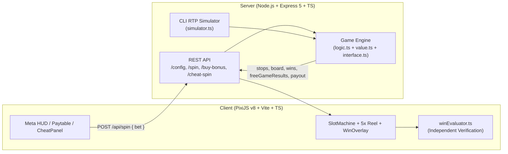

# CYBER NEXUS — 5×3 High-Tech Slot Machine


A full-stack **5×3, 10-payline video slot** built from scratch with **TypeScript**, **Node.js (Express)**, and **PixiJS v8**, featuring a custom high-tech vector sprite kit, server-authoritative game math, independent client-side win verification, Free Games with retriggers, Buy Bonus, and a high-speed Monte Carlo RTP simulator.

> **Portfolio / Educational Demo:** This project is a technical demonstration of iGaming client/server architecture and slot mathematics. It uses a local demo balance only — there is no real-money wagering, user accounts, or payment processing.

---

## Features

- **Server-Authoritative Math Engine** — All reel stops are generated on the server using Node's CSPRNG (`crypto.randomInt`) over five ordered 100-stop reel strips. The client never sends boards or payouts.
- **Independent Client-Side Cross-Verification** — After every spin (base game & each Free Game), the client independently reconstructs the `5×3` board from `stops` + `/api/config` rules and verifies every payline, Scatter count, retrigger, and payout against the server response. Any divergence triggers a `WinMismatchError` alert banner.
- **Authentic 3-Phase Reel Physics** — Smooth `SPINNING → LANDING → SETTLE` state machine driven by `app.ticker`, with constant spin speed, staggered left-to-right stops, subtle mechanical settle bounce, and **Slam Stop** (press `SPIN` again mid-spin to land immediately with animation).
- **Rich Slot UX & Animations** — **Hold `SPIN` for Auto-Spin** with neon charge bar, **Buy Bonus** (guarantees 3 Scatters on Reels 1, 3, and 5), **Free Games with Retriggers** (`+5 / +10 / +15` spins), animated popups, parallel multi-line win tracks + sequential single-line showcase, and custom win animations for `Wild`, `Scatter`, `H1`, and `H2`.
- **Dynamic Paytable Overlay** — Populated live from `GET /api/config` (symbol names, tiers, multipliers, and Free Games rules — zero hardcoded payouts on the client).
- **Monte Carlo RTP Simulator** — CLI simulator running at **~440,000 spins/sec** with 95% confidence interval, volatility ($\sigma$), win distribution buckets, and per-symbol RTP breakdown.
- **Developer Cheat Panel (`Ctrl + D`)** — Built-in slide-out dev panel to trigger `H1 Win`, `H2 Win`, `Wild Win`, `Scatter 3`, `Scatter 4`, and `Scatter 5` using real reel stops.
- **Custom High-Tech SVG Sprite Kit** — Modular, separate vector sprites for all 13 symbols, reel frame, laser dividers, badges, background, and HUD controls (with a standalone visual gallery at `assets/sprites/preview.html`).

---

## Architecture



---

## Game Math & Paytable

Full 4-page mathematical specification with all 500 ordered reel stops: **[math/slot-math-lmh-ww-reels-en.pdf](./math/slot-math-lmh-ww-reels-en.pdf)**.

### Specifications

| Parameter | Value |
| :--- | :--- |
| Grid | `5 reels × 3 visible rows` |
| Paylines | `10 fixed paylines` (left-to-right, best win per line) |
| Reel Strips | `5 independent 100-stop strips` |
| Bet Range | `1 – 10,000` line bet (`totalBet = bet × 10`) |
| Wild (`WW`) | Substitutes for all regular symbols (`H`, `M`, `L`), not `SC`; 5× `WW` pays as 5× High (`2,500×`) |
| Scatter (`SC`) | Counts anywhere in the 15 visible cells: `3 → 5 FG`, `4 → 10 FG`, `5 → 15 FG` (retriggers enabled) |
| Buy Bonus | `5× totalBet` — guarantees 3 `SC` on Reels 1, 3, and 5 |
| Theoretical RTP | **92.91%** base game / **~96.10%** total (with Free Games & retriggers) |

### Paytable (`× line bet`)

| Symbol ID | Code | Name | Tier | Stops / Reel | 3× | 4× | 5× |
| :---: | :---: | :--- | :---: | :---: | :---: | :---: | :---: |
| `0` | `WW` | Quantum AI Core | Wild | 2 | — | — | `2,500` (as High) |
| `1` | `H1` | Hyper Rocket | High | 4 | `150` | `600` | `2,500` |
| `2` | `H2` | Plasma Blaster | High | 4 | `150` | `600` | `2,500` |
| `3` | `M1` | Cyber Jetpack | Mid | 7 | `75` | `300` | `1,000` |
| `4` | `M2` | Energy Battery | Mid | 7 | `75` | `300` | `1,000` |
| `5` | `M3` | AI Microchip | Mid | 7 | `75` | `300` | `1,000` |
| `6`–`11` | `L1`–`L6` | Cyber Glyphs `A, K, Q, J, 10, 9` | Low | 11 each | `30` | `120` | `500` |
| `12` | `SC` | Singularity Portal | Scatter | 3 (min gap 32) | `5 FG` | `10 FG` | `15 FG` |

---

## Project Structure

```text
demoSlot/
├── assets/
│   └── sprites/
│       ├── symbols/           # 13 separate high-tech symbol SVGs (IDs 00–12)
│       ├── machine/           # Background, 5x3 frame, laser divider, 10 LINES badge, win frame
│       ├── ui/                # SPIN, BUY BONUS, -, +, MAX BET, Info, meters, dock
│       ├── manifest.json      # Machine-readable sprite & symbol mapping
│       └── preview.html       # Standalone sprite kit gallery & PNG exporter
├── client/
│   └── src/
│       ├── api/slotApi.ts     # Typed REST client (/config, /spin, /buy-bonus, /cheat-spin)
│       ├── game/
│       │   ├── SlotMachine.ts # Dynamic grid container driven by server config
│       │   ├── Reel.ts        # 3-phase reel physics, Slam Stop & symbol win animations
│       │   ├── WinOverlay.ts  # Parallel multi-line tracks + sequential single-line cycle
│       │   ├── Meta.ts        # Top/Bottom HUD, Buy Bonus & tactile button animations
│       │   ├── PaytableOverlay.ts
│       │   ├── FreeGamesOverlay.ts
│       │   ├── CheatPanel.ts  # Ctrl+D developer preset panel
│       │   └── winEvaluator.ts# Independent client-side win & board verifier
│       ├── assets.ts          # PixiJS v8 asset preloader
│       ├── config.ts          # Logical stage & HUD layout constants
│       └── main.ts            # Application bootstrap & game loop
├── server/
│   ├── src/
│   │   ├── game/
│   │   │   ├── interface.ts   # Shared enums, symbol names, error codes & contracts
│   │   │   ├── value.ts       # Reel strips, paylines, paytable & wager config
│   │   │   └── logic.ts       # Spin engine, Buy Bonus, cheats & exact RTP calculator
│   │   ├── routes/api.ts      # Express 5 router + Zod validation + rate limiting
│   │   ├── simulator.ts       # High-speed Monte Carlo RTP CLI simulator
│   │   ├── app.ts             # Express app (API + optional static client serving)
│   │   └── server.ts          # HTTP server entry point
│   ├── test/                  # Node built-in unit & API integration tests
│   └── Dockerfile
├── math/
│   └── slot-math-lmh-ww-reels-en.pdf
├── scripts/
│   ├── dev.mjs                # Runs server & client together in one terminal
│   └── generate-sprites.mjs   # Procedural SVG sprite kit generator
├── render.yaml                # One-click Render.com Free Tier blueprint
└── package.json               # Root workspace scripts
```

---

## Quick Start

### Prerequisites

- **Node.js `>= 18.12.0`** (Node.js 22 LTS recommended) and **npm**

### Install Dependencies

```bash
npm --prefix server install
npm --prefix client install
```

### Run Locally (Single Terminal)

```bash
npm run dev
```

This starts both services simultaneously with prefixed logs:
- **API Server:** `http://localhost:3000`
- **PixiJS Client:** `http://localhost:8080` (open this URL in your browser)

### Production Build

```bash
npm run build
```

---

## Controls & Shortcuts

| Action | Behavior |
| :--- | :--- |
| **Click `SPIN`** | Starts a paid spin (`bet × 10`) |
| **Click `SPIN` while spinning** | **Slam Stop** — immediately lands all 5 reels with smooth animation |
| **Hold `SPIN` (`0.55s`)** | Activates **Auto-Spin** (shows charge bar & `AUTO ON` badge); short click stops Auto-Spin |
| **`-` / `+` / `MAX BET`** | Cycles line bet presets (`1` to `10,000`) |
| **`BUY BONUS`** (left) | Deducts `5× totalBet` and lands 3 Scatters on Reels 1, 3, and 5 → 5 Free Games |
| **`i`** (top-right) | Opens dynamic Paytable & Rules overlay |
| **`Ctrl + D`** | Toggles the **Dev Cheat Panel** (`H1 Win`, `H2 Win`, `Wild Win`, `Scatter 3/4/5`) |

---

## API Reference

| Method | Endpoint | Description |
| :--- | :--- | :--- |
| `GET` | `/healthz` | Health check (`{ "status": "ok" }`) |
| `GET` | `/api/config` | Returns grid dimensions, `symbolInfo`, `reelStrips`, `paylines`, `payoutMultipliers`, `freeGamesAwards`, `bonusBuyMultiplier`, and wager limits |
| `POST` | `/api/spin` | Runs a paid spin. Body: `{ "bet": 25 }`. Returns `roundId`, `stops`, `board`, `wins`, `baseGamePayout`, `freeGameResults`, `payout`, `net` |
| `POST` | `/api/buy-bonus` | Runs a Buy Bonus spin (`3 SC` on reels 1, 3, 5). Body: `{ "bet": 25 }` |
| `POST` | `/api/cheat-spin` | Developer test spin. Body: `{ "bet": 25, "cheat": "h1_win" \| "h2_win" \| "wild_win" \| "scatter_3" \| "scatter_4" \| "scatter_5" }` |

---

## Testing & RTP Simulation

### Run Server Unit & API Tests

```bash
npm run test:server
```

### Run Monte Carlo RTP Simulator

```bash
# Default: 1,000,000 spins (line bet = 1)
npm run simulate

# Custom spin count & line bet
npm run simulate -- 5000000
npm run simulate -- --spins 20000000 --bet 25
```

Sample output (~440k spins/sec):

```text
----------------------------------------------------------------
 SLOT SIMULATION
----------------------------------------------------------------
 Spins:             20,000,000
 Line bet:          1  (paylines: 10, per spin: 10)
 Time:              45.49 s  (439,675 spins/s)

 RTP
   Total RTP:               96.0527%  (+/- 0.1906% at 95% confidence)
   Base game:               92.9659%
   Free Games:              3.0869%
----------------------------------------------------------------
```

---


## License

Built for educational and portfolio purposes.
